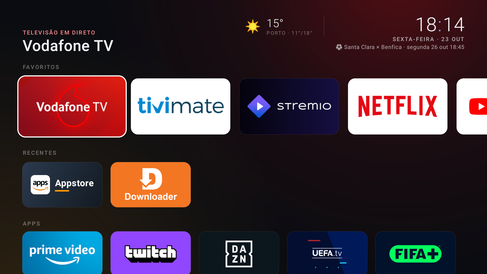
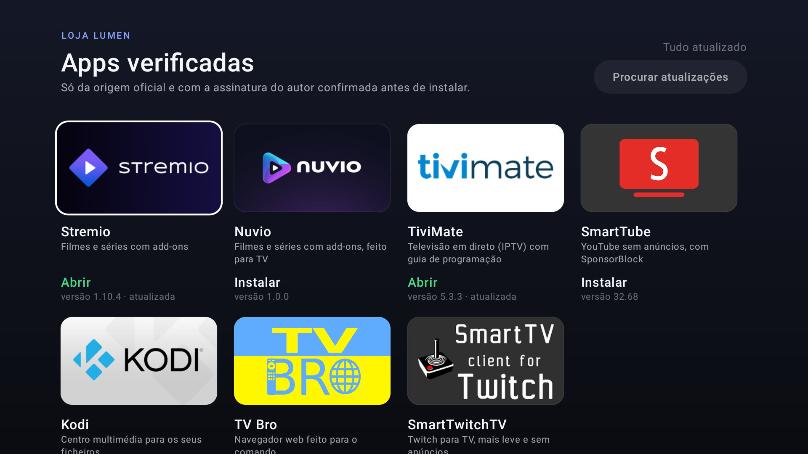
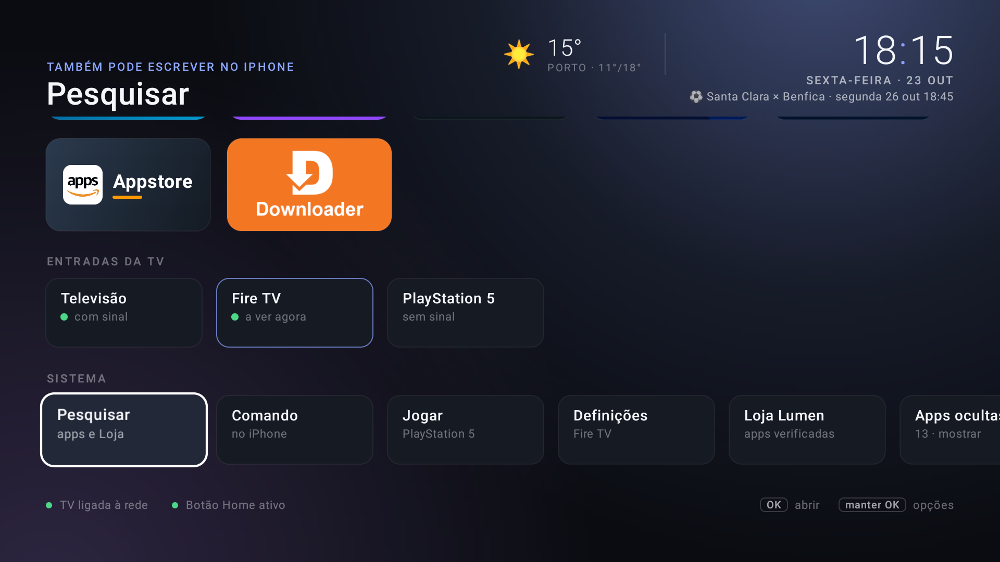

<div align="center">

# Lumen

**Um ecrã inicial moderno, rápido e sem anúncios para o Amazon Fire TV — integrado com a TV pela rede.**

Feito para um Fire TV Stick 4K (2.ª geração, Fire OS 8) ligado a uma Hisense 43A7500F (VIDAA U4), sem root e totalmente reversível.


-FF9900?logo=amazon&logoColor=white)




</div>

## O que faz

| | |
|---|---|
| **Ecrã inicial próprio** | Substitui o da Amazon ao arrancar e no botão Home. Favoritos, recentes, todas as apps — tudo reordenável, com apps ocultáveis. Fundo "aurora" com a cor da app em foco. |
| **Integração com a TV** | Volume, silêncio, entradas HDMI e energia da TV Hisense pela rede (MQTT). A TV desliga quando o Fire TV adormece e liga por CEC ao tocar no comando. |
| **Comando no iPhone** | Página servida pelo próprio Lumen (QR code no ecrã). Setas, OK, Voltar, volume, entradas, favoritos e pesquisa — funciona em **qualquer** app, porque as teclas vão para a TV e seguem por HDMI‑CEC para o Fire TV. Adiciona‑se ao ecrã principal como uma app. |
| **Loja Lumen** | Apps que não existem na Appstore (Stremio, Nuvio, TiviMate, SmartTube, Kodi, TV Bro, SmartTwitchTV), sempre da origem oficial e com a **assinatura do autor verificada** antes de instalar. Procura atualizações sozinha. |
| **Topo informativo** | Relógio, meteorologia (Open‑Meteo) e próximo jogo da equipa (ESPN), sem contas nem chaves. |
| **Ecrã ambiente** | Proteção de ecrã com fotografias do dia em movimento lento, relógio, tempo e próximo jogo. |
| **Extras** | Pesquisa (também a partir do iPhone), temporizador para desligar, atalho "Jogar" para a PlayStation 5, aviso quando uma atualização do Fire OS mexe em algo. |

<div align="center">
 
</div>

## Como funciona (sem root)

- **Botão Home:** o Fire OS 8 não deixa trocar a app inicial. Um serviço de acessibilidade repara quando o ecrã da Amazon fica à frente (arranque, Home, sair de uma app) e traz o Lumen. Não lê o conteúdo do ecrã.
- **TV pela rede:** a Hisense tem um broker MQTT (porta 36669, TLS com o certificado público da app de comando oficial). Emparelha‑se uma vez com PIN.
- **Teclas do iPhone em qualquer app:** `KEY_UP/OK/RETURNS…` enviadas à TV são reencaminhadas por HDMI‑CEC para o Fire TV (verificado no registo CEC do Stick).
- **Loja:** descarrega da origem oficial, confirma pacote, versão e certificado de assinatura (SHA‑256 fixado), e só então entrega ao instalador do sistema (o Fire OS pede sempre um "Instalar").

## Estrutura

```
android/app/src/main/java/pt/tomas/lumen/
  LumenApp.kt            objetos partilhados (um processo, mantido vivo pelo serviço)
  MainActivity.kt        ecrã inicial
  HomeGuardService.kt    botão Home → Lumen, Fire a adormecer → TV desliga, arranque do comando
  SleepTimer.kt · UpdateWatch.kt · BootReceiver.kt
  ambient/               ecrã ambiente (fotos, relógio) e cache de fotos
  data/                  apps, preferências, meteorologia e futebol
  remote/                servidor HTTP do comando do iPhone
  store/                 catálogo e motor da Loja Lumen
  tv/                    controlo da TV Hisense (MQTT/TLS)
  ui/                    ecrã inicial, topo, cartões, menu, loja, pesquisa, QR code
android/app/src/main/assets/
  remote/                página do comando (HTML/PWA)
  store/                 banners oficiais das apps da loja
  hisense/               certificado de cliente público (ver Segurança)
tools/                   scripts PowerShell/Python para o PC (ADB, diagnóstico, instalação, medição)
```

## Compilar e instalar

Requisitos: Android SDK (platform 35, build‑tools 35), **JDK 17** (o JBR do Android Studio recente é Java 25, incompatível com Gradle 8.11), ADB, e a depuração ADB ativa no Fire TV.

```powershell
$env:JAVA_HOME = 'C:\Program Files\Microsoft\jdk-17...'
cd android; .\gradlew.bat assembleRelease; cd ..
powershell -ExecutionPolicy Bypass -File tools\lumen.ps1 -Acao instalar   # instala, compila AOT, ativa o serviço
python tools\hisense_pair.py pedir; python tools\hisense_pair.py codigo 1234   # emparelhar a TV (PIN no ecrã)
```

### Ferramentas

| Script | Para quê |
|---|---|
| `tools/diagnostico.ps1` | Diagnóstico só de leitura do Fire TV |
| `tools/lumen.ps1` | `instalar` · `ativar` · `desativar` · `protetor` · `protetor-amazon` · `remover` |
| `tools/aliviar.ps1` | Desativa (não desinstala) telemetria, anúncios e apps sem uso da Amazon · `reverter` repõe |
| `tools/fase1.ps1` | Animações 0,5× e CEC, com cópia dos valores originais |
| `tools/perf.ps1` | Mede a fluidez com um percurso fixo (`-Amazon` mede o ecrã original para comparar) |
| `tools/stremio-atualizar.ps1` | Atualiza o Stremio oficial com verificação de assinatura |
| `tools/hisense_pair.py` | Emparelhamento e testes do controlo da TV |

## Reverter

| O quê | Como |
|---|---|
| Voltar ao ecrã da Amazon (mantém o Lumen) | `tools\lumen.ps1 -Acao desativar` |
| Remover o Lumen | `tools\lumen.ps1 -Acao remover` |
| Proteção de ecrã da Amazon | `tools\lumen.ps1 -Acao protetor-amazon` |
| Serviços da Amazon desativados | `tools\aliviar.ps1 -Acao reverter` |
| Animações/CEC | `tools\fase1.ps1 -Acao reverter` |
| Último recurso | Reposição de fábrica do Fire TV |

## Segurança e privacidade

- Sem root e sem flashing. DRM (Widevine/PlayReady/HDCP 2.2) intacto: Netflix, Disney+ e afins continuam em 4K/HDR.
- O comando do iPhone só aceita pedidos da rede local **com um código secreto** (no QR code); o código fica só no Stick.
- Certificado MQTT: emitido pela CA da Hisense para `remoteclientmobile` (válido até 2043); já é público e só é usado na rede local. A TV só aceita comandos de identidades emparelhadas por PIN.
- Meteorologia, futebol e fotos são apenas leituras públicas; o Lumen não envia dados do utilizador.

### Loja Lumen

| App | Origem oficial | Certificado (SHA‑256) |
|---|---|---|
| Stremio | stremio.com/downloads → dl.strem.io | `7e6a979c…a8022c6b` (Ivo Georgiev, Stremio) |
| Nuvio | github.com/NuvioMedia/NuvioTV | `1cba06fb…830e5210` (NuvioTV) |
| TiviMate | tivimate.com/apk → files.tivimate.com (deteção por ETag) | `cafa2c5e…8fca2c5b` (Alexey Rabets) |
| SmartTube | github.com/yuliskov/SmartTube | `109735aa…2eda482a` (Yurii L., SmartTube) |
| Kodi | mirrors.kodi.tv (só estáveis) | `f517b44b…3499b8d5` (XBMC Foundation) |
| TV Bro (variante leve) | github.com/truefedex/tv-bro | `1e5124be…43047c75` (Pheodor Tsapana, PhloX) |
| SmartTwitchTV | github.com/fgl27/SmartTwitchTV | `838d9d90…d63744d9` (Felipe Leon) |

Excluídas de propósito por existirem na Appstore da Amazon (que as atualiza): VLC, LocalSend, Moonlight, Aerial Views, Just Player, Downloader.

## Desempenho — lições deste Stick (PowerVR GE8300, interface a 1080p)

| Versão | Frames lentos | p90 |
|---|---|---|
| Ecrã original da Amazon | 46 % | 26 ms |
| Lumen v0.2 | 30–37 % | 23 ms |
| Lumen v0.3+ | **10–18 %** | **16–21 ms** |

- Nada de gradientes, sombras desfocadas ou camadas transparentes de ecrã inteiro desenhados pela GPU: a aurora é pintada pela CPU numa imagem 192×108 e ampliada (95 % → 10 % de frames lentos).
- O estado que muda com o foco é lido só onde é usado, para não recompor o ecrã inteiro.
- APK compilado AOT ao instalar. Nunca `am force-stop` o Lumen: o Fire OS desliga‑lhe o serviço de acessibilidade.

## Limitações conhecidas

- O volume e o botão de energia do **comando Fire** usam infravermelhos: é preciso um perfil IR válido para a TV (o Lumen não consegue intercetar essas teclas).
- O Home dentro da página da Appstore (que no Fire OS 8 vive dentro do ecrã da Amazon) não é detetável; usa‑se Voltar.
- Ao carregar em Home, o ecrã da Amazon aparece ~0,2 s antes do Lumen.

---

<sub>Projeto pessoal, sem afiliação com a Amazon, a Hisense ou os autores das apps referidas. Marcas e logótipos pertencem aos respetivos donos.</sub>
